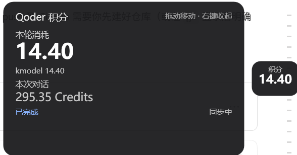

# Qoder Credits Overlay

Qoder Credits Overlay 是一个面向 Windows 的 Qoder 积分悬浮窗工具，可实时显示本轮 Credits 消耗、分模型明细和会话累计，并在任务完成后提供消耗提示。窗口随 Qoder 移动和切换，支持展开查看、拖动定位及位置记忆。



## 安装配置

安装 Node.js 24 或更高版本后，在 PowerShell 中运行：

```powershell
git clone https://github.com/ZhihaoQiao233/qoder-credits-overlay.git
cd qoder-credits-overlay
npm run install-hooks
```

项目无第三方依赖，无需执行 `npm install`。

首次运行会启动一个独立的 Edge 配置窗口并打开 Qoder 用量页，请在这个窗口里登录一次。该配置与日常浏览器的书签、密码和登录状态互不影响，之后后台同步无需再次登录。

安装完成后，在 Qoder 中提交一条新消息，悬浮窗会自动启动。也可以在项目目录手动启动：

```powershell
npm run watch
```

当前仅支持 Windows，已验证环境为 Windows 11、PowerShell 5.1、Node.js 24 和 Qoder Desktop 0.4.11。

## 使用说明

胶囊默认位于 Qoder 窗口左侧，可拖动调整位置，重启后保留。点击胶囊展开明细，右键明细卡收起。

悬浮窗跟随 Qoder 移动，切换到其他窗口时随 Qoder 一起被遮挡，最小化时隐藏。它只显示当前打开的那个对话，切换到别的对话时不会带出上一个对话的数值。

任务运行期间显示“记录中 · 待结清”；任务停止后自动转为官网实扣，并在随后约两分钟内每 5 秒刷新一次，因此官网结算完成后几秒内就能对齐。

首次安装后需提交一条消息，以获取会话路径。界面显示“等待官网同步”时，表示该轮还没有拿到官网记录。

## 数据来源

积分优先取自 Qoder 官网用量明细。程序用一个独立的 Edge 配置目录打开 `https://qoder.com/account/usage`，在页面内读取当前账号的逐轮扣费记录，再按 `session_id` + `business_id`（即 Hook 的 `requestSetId`）与本地轮次一一对应。只有两边 ID 完全一致时才采用官网数值，绝不按时间或比例摊分。这个配置目录默认为 `%LOCALAPPDATA%\QoderCredits\edge-billing-profile`。

程序不读取、不复制、不外传 Cookie、Token 或其他登录凭据，也不接触 Qoder 客户端的登录文件；同步只发往 qoder.com，不经任何第三方。官网暂时不可用时，悬浮窗保留上次缓存并标注“官网缓存”或具体同步状态。

官网的计费行在任务停止后仍会继续结算，金额和结束时间都可能再变，所以程序在停止后的短时间内会加密轮询，直到数值稳定。

官网不可用时，积分回退到 Qoder 的本地计费记录。主对话以及上下文压缩、记忆生成、技能演进等后台调用，均通过请求 ID 关联到对应轮次。免费请求计为 0，不通过 token 数和单价估算。

运行缓存、窗口位置和错误日志位于（缓存只保存计费元数据，不保存对话正文）：

```text
%LOCALAPPDATA%\QoderCredits
```

<details>
<summary>统计原理与对账工具</summary>

主对话取会话记录中的 `usage.credits`，后台调用取 worker 日志中的逐请求计费字段，只有 `billable=true` 才计入消耗。官网数据按整数分累加，重复行会去重；同一个 `session_id` + `business_id` 出现互相矛盾的金额或计费状态时，整份快照作废，而不是挑其中一条显示。

总账读取复用了客户端内置的固定密钥，不是用户的登录凭据。如果客户端更换密钥，总账对账会停用，日志和会话记录的统计仍会继续。

需要核对某个会话时，可以运行：

```powershell
node tools/selfcheck.mjs "C:/path/to/session.jsonl" "C:/path/to/workspace"
node tools/audit-usage.mjs "C:/path/to/session.jsonl" "C:/path/to/workspace"
```

`selfcheck.mjs` 查看总账与会话记录的差额，`audit-usage.mjs` 列出逐轮计费归属。输出包含本机路径和会话 ID，分享前请检查内容。

修改代码后可以运行 `npm test`，覆盖解析、官网快照校验、ID 归属和悬浮窗显示逻辑。

</details>

## 配置与卸载

安装时会在 `%USERPROFILE%\.qoder\settings.json` 中注册三个 Hook，接收任务开始、结束和会话关闭事件。运行期间需保留项目目录；移动目录后，重新执行 `npm run install-hooks`。

卸载时，在项目目录运行：

```powershell
npm run uninstall-hooks
```

该命令移除本项目的 Hook，保留其他设置。已运行的悬浮窗和监视器需另行结束，本地缓存不会自动删除。

## 问题反馈

Qoder 升级可能改变本地日志格式。如遇用量不更新、窗口定位异常等问题，可在 [Issues](https://github.com/ZhihaoQiao233/qoder-credits-overlay/issues) 中附上 Qoder 版本、问题描述和截图，请勿上传完整会话日志。

个人维护的非官方工具。[MIT License](LICENSE)。
