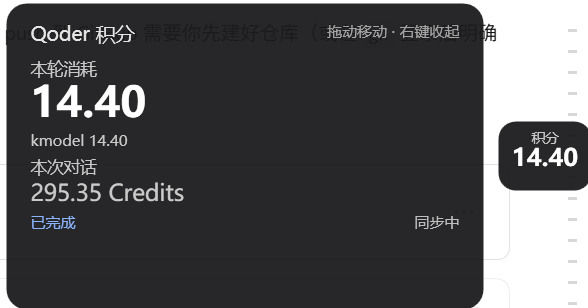

# qoder-credits-overlay

**A Windows overlay that shows your real-time Qoder Credits deduction — only actual per-request billing, never estimates.**

一个悬浮在 Qoder 窗口边缘的小胶囊，实时显示本次对话的实际积分扣减。只统计真实计费请求，不做任何按比例估算，也不把总额摊到单轮。



## 特性

- **只显示实扣**：数据来自 Qoder 客户端本地日志里逐请求的计费记录（`ForkCompletionBilling`），`billable=false` 的请求记 0。估算、摊派一概没有。
- **按模型分桶**：本轮消耗与会话累计都按模型分开统计。
- **隐藏扣减也归位**：compact / memory / skill 等后台子请求的费用，通过 requestId 精确 join 回它们所属的那一轮，而不是留在会话级黑盒里。
- **总账对账**：只读解密 Qoder 写在会话目录的 `state.json` 总账（AES-256-GCM），把日志口径和客户端总账对齐，误差方向可解释（已计费未落盘）。
- **贴窗悬浮**：胶囊默认吸附在 Qoder 窗口左边缘（内缩 10px、垂直居中），可拖动、落点持久化；左键展开详情、右键收起；Qoder 最小化或收进托盘时整体隐藏。
- **零依赖**：Node.js 只用内置模块，overlay 是 PowerShell + WPF，不装任何 npm 包。

## 安全模型

这是本项目最重要的部分：

- **只读本机文件**，不发起任何网络请求。
- **不碰任何凭据**：不读、不解密、不打印 `%APPDATA%\com.qoder.app.stable\auth.v1.dat`，不接触任何 token / cookie。
- usage-log 解析只白名单四类计费元数据行，**不存 prompt 内容**。
- 所有运行时数据（事件流、归属缓存、错误日志）都写在 `%LOCALAPPDATA%\QoderCredits`，不污染仓库。

`state.json` 的主密钥硬编码在 Qoder 客户端程序里（`qoder-worker-runtime.obf.mjs`），本项目只是复用它做**只读**对账；客户端换密钥时对账自动降级为 transcript 口径，不会崩。

## 环境要求

- Windows 10/11（overlay 依赖 PowerShell 5.1 + WPF）
- [Qoder](https://qoder.com) 桌面客户端
- Node.js ≥ 18

## 安装

```powershell
git clone https://github.com/<you>/qoder-credits-overlay.git
cd qoder-credits-overlay
npm run install-hooks   # 向 ~/.qoder/settings.json 写入三条 hook（UserPromptSubmit/Stop/SessionEnd）
npm run watch           # 前台启动 watcher；想后台跑用 Start-Process node src/watcher.js -WindowStyle Hidden
```

watcher 会通过单实例锁（`watcher.lock`）防止重复启动，并自动拉起 overlay 进程；overlay 侧有互斥锁 `Local\QoderCreditsOverlay`。

## 卸载

```powershell
npm run uninstall-hooks   # 从 settings.json 移除 hook（只删本项目写入的条目）
```

再结束 watcher 进程即可。hook 条目带 `qoder-credits-overlay` 标记，不会误伤其他配置。

## 使用

- 胶囊默认贴在 Qoder 窗口左边缘，**拖动**可换位置，重启后仍在原位。
- **左键**（未拖动时）展开详情卡：**右键**收起。
- Qoder 最小化/收托盘时胶囊整体隐藏；被其他窗口盖住时不抢置顶——这是有意设计，胶囊的职责是不挡事。

## 调试工具

- `node tools/selfcheck.mjs` — 解密本地总账，打印总账口径、transcript 口径与残差。
- `node tools/audit-usage.mjs` — 离线对账：把 usage-log 证据、transcript、总账三方 join，逐模型核对。

## 测试

```powershell
npm test    # 62 个用例：解析、归属、原子写、校准降级、overlay 脚本 AST 等
```

## 免责声明

本项目是**非官方**的独立作品，与 Qoder 及其开发商无任何隶属、赞助或认可关系。Qoder 是 Qoder Inc. 的商标。项目通过阅读本机客户端日志工作，日志格式随客户端版本变化时相关功能可能失效——欢迎提 issue 或 PR。

## License

[MIT](LICENSE)
